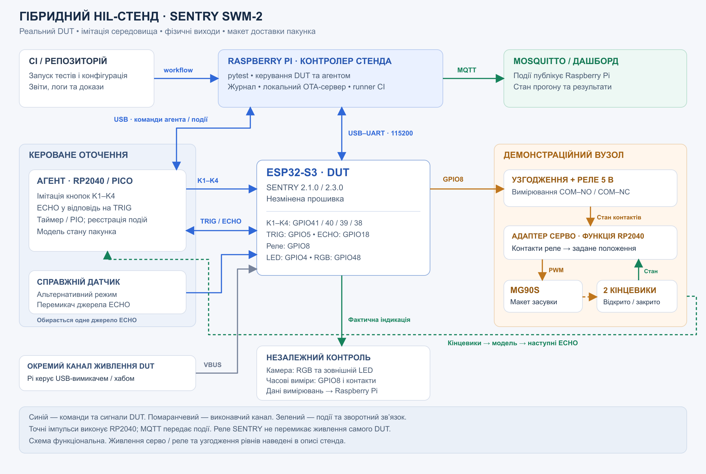

# Теоретичний HIL-стенд SENTRY SWM-2

## Призначення

Гібридний стенд для автоматизованої перевірки SENTRY SWM-2 на ESP32-S3: електрична імітація датчика та кнопок поєднується з фізичним реле, індикацією й макетом засувки для доставки пакунка. Raspberry Pi запускає тести, збирає докази та передає результати до CI.

Об'єкт тестування — SENTRY із прошивками 2.1.0 stable та 2.3.0 beta. Очікувана поведінка визначається [PRD](../reference/PRD.md). Сюжет доставки пояснює практичне застосування виходів модуля; серво та засувка утворюють окремий демонстраційний вузол.

## Архітектура

| Блок | Призначення |
|---|---|
| Raspberry Pi | Контролер стенда: pytest, зв'язок із DUT та агентом, журнал подій, звіти, локальний сервер OTA. |
| ESP32-S3 N16R8 — DUT | Реальна плата з незміненою прошивкою SENTRY. Отримує команди UART, сигнали датчика та натискання кнопок; формує виходи реле й індикації. |
| Raspberry Pi Pico на RP2040 | Допоміжний агент: імітація кнопок, формування ECHO у відповідь на TRIG, реєстрація електричних переходів, адаптер серво. Імпульси виконує локально апаратним таймером або PIO. |
| Датчик відстані та перемикач джерела | Два режими: справжній датчик із контрольною мішенню або електричний емулятор. Вхід ECHO одночасно підключений лише до одного джерела. |
| Реле та узгодження рівнів | GPIO8 керує фізичним реле через сумісний інтерфейс. Контакти COM–NO / COM–NC читає агент через низьковольтний вимірювальний ланцюг. |
| LED та оптичний контроль | Зовнішній LED GPIO4, вбудований RGB GPIO48, камера з фіксованими експозицією й освітленням. |
| MG90S, засувка, два кінцевики | Макет відкриття й закриття. Кінцевики підтверджують обидва положення; рух на відео доповнює вимірювання. |
| Керований канал живлення DUT | Окремий USB-вимикач або керований хаб із фактичним відключенням VBUS. Потрібний для циклів живлення й відновлення після збою. |
| Mosquitto | Локальний MQTT-брокер для подій стенда та перегляду результатів. Дані публікує програма на Raspberry Pi. |

Pico, кінцевики, оптичний контроль і керований канал живлення входять до проєкту майбутньої лабораторії. Поточний макет ESP32 із датчиком, кнопками та LED є початковим етапом цієї архітектури.

## Інтерфейси та живлення

| Інтерфейс DUT | Зв'язок зі стендом |
|---|---|
| USB–UART, 115200 8N1 | Команди та повний TX/RX-журнал. Портом володіє один процес; він передає події тестам і MQTT-мосту. |
| GPIO41 / 40 / 39 / 38 | K1 / K2 / K3 / K4. Агент імітує замикання на GND через open-drain ключі; відпущена кнопка має високий імпеданс. |
| GPIO5 → TRIG; GPIO18 ← ECHO | Агент приймає TRIG і повертає імпульс для заданої відстані або пропускає відповідь для сценарію «немає еха». |
| GPIO8 → реле | Окремо фіксуються логічний сигнал, стан фізичних контактів і реакція макета. |
| GPIO4 → зовнішній LED | Active LOW; анод через 220–330 Ом підключений до 3V3. Камера перевіряє фактичне світіння. |
| GPIO48 → вбудований RGB | Камера перевіряє колір, режими та відносну зміну яскравості. |

Логічні лінії DUT та агента працюють із рівнями 3,3 В. Наявний датчик із перемичкою UART SELECT використовується в режимі TRIG/ECHO: перемичка знята, живлення 3,3 В. Тип модуля уточнюється за маркуванням; це відмінність фактичного комплекту від HC-SR04 у базовій схемі курсу.

Наявне реле має котушку 5 В, тому живиться від відповідного джерела; його вхід IN узгоджується з GPIO8 за схемою конкретного модуля. MG90S також має окрему лінію живлення 5 В із достатнім запасом струму. Сигнали 5 В не подаються на GPIO ESP32 або Pico. Для неізольованих сигнальних каналів передбачається спільна GND.

Реле SENTRY є виходом DUT. Живлення самого DUT перемикає інший, незалежний канал стенда. При вимкненні усувається підживлення через USB та сигнальні лінії; запуск агента не повинен створювати натискання або ECHO на знеструмленому DUT.

## Імітація середовища та зворотний зв'язок

У режимі емуляції тест задає агенту послідовність відстаней, кількість пропущених відповідей та тривалість натискань. Агент формує ECHO після кожного TRIG; перетворення відстані на тривалість імпульсу попередньо перевіряється логічним аналізатором. Raspberry Pi координує сценарій, а точні імпульси виконуються на RP2040.

У режимі справжнього датчика перед ним розміщується мішень на виміряній відстані. Цей режим перевіряє фізичний вимірювальний тракт; електричний емулятор дозволяє повторювати граничні значення та відсутність еха. Режим і стан перемикача фіксуються в конфігурації прогону.

У демонстраційному режимі агент читає фізичні контакти реле: стан ON задає серво відкриття засувки, OFF — закриття. Два кінцевики підтверджують досягнуте положення. У сценарії з моделлю пакунка відкриття змінює стан моделі «пакунок утримується / вийшов із зони», а модель задає наступні ECHO. Так вихід DUT впливає на подальший сигнал його оточення. Профіль відстані до поверхні задається окремо й не змінюється лише через перемикання реле.

Для коротких pulse та повторюваних schedule серво переводиться в режим спостереження без руху: вимірюються GPIO8 і контакти реле. Швидкодія механіки не підміняє тривалість електричного імпульсу з PRD.

## Демонстраційний сценарій доставки

1. Стенд перевіряє версію, доступ UART, Wi-Fi, вхід користувача та початкові стани. У beta Guard знято з охорони; автоматичне керування реле й розклад вимкнені.
2. Коротке K1 вмикає лампу — індикацію підготовки. Камера та UART фіксують реакцію.
3. K3 запускає виміри. Стенд подає заданий профіль відстані, оператор спостерігає показання.
4. Коротке K2 вмикає реле. Агент реєструє замикання контактів, адаптер задає рух серво, кінцевик підтверджує відкриття засувки макета.
5. Стенд зберігає послідовність «дія → вихід → контакти → положення», завершує виміри, вимикає реле й перевіряє повернення макета в початкове положення.

Автоматичне блокування скиду за відстанню та затримка руху після PANIC є можливими новими вимогами виробу. У поточній SENTRY K3 запускає вимірювання, а K4 у beta підтверджує alert або викликає PANIC при утриманні. PANIC вмикає реле за GD-3; це враховується окремим сценарієм, поза звичайною демонстрацією доставки. У stable функції K4 відповідають E099.

## Що стенд перевіряє

| Напрям | Вплив і незалежне спостереження | Зв'язок із документацією |
|---|---|---|
| Лампа | UART / K1 → стан, кольори, яскравість і режими; UART плюс камера. | LM-1–LM-8; початкові кейси TC-LM-01–TC-LM-10. |
| Реле | UART / K2 → GPIO8, COM–NO / COM–NC, зовнішній LED; імпульси, розклад і лічильник. | RL-1–RL-7; початкові кейси TC-RL-01–TC-RL-09. |
| Телеметрія | Налаштування інтервалу, одноразові та періодичні звіти, відновлення налаштувань. | HL-1–HL-3; TC-HL-01–TC-HL-05. |
| Акаунт | UART-вхід, відмова доступу, lockout, зміна пароля й перевірка після перезапуску. | AU-1–AU-5; TC-AU-01–TC-AU-06. |
| Alerts | Створення та ack за фактичним ID, clear, застосовність E099 у stable. | AL-1–AL-4; TC-AL-01–TC-AL-06. |
| Розширення HIL | Відстані біля порогів, відсутність еха, кнопки та реакції Guard у beta; сценарії живлення й OTA. | DS-1–DS-7, GD-1–GD-5, розділ 12, OTA-1–OTA-12. |

Таблиця описує можливості архітектури. Початковий обсяг виконання визначають [тест-план](TEST_PLAN.md) та [36 тест-кейсів](TEST_CASES.md); додаткові HIL-сценарії додаються окремо.

## Збір доказів і Mosquitto

Для кожного запуску зберігаються ID прогону й кейсу, версії DUT та агента, конфігурація стенда, вхідні дані, UART TX/RX, переходи GPIO8, стан контактів і кінцевиків, фото або відео та підсумковий результат. Часові інтервали всередині агента вимірюються його монотонним таймером; зв'язок із журналом хоста встановлюється за ID команд і подій.

Для часових перевірок враховуються роздільність та похибка вимірювання. Власні допуски стенда й час руху засувки позначаються як параметри проєкту, а не вимоги PRD. Камера дає якісну перевірку кольору й зміни яскравості; точні RGB-значення та абсолютна світність потребували б каліброваного оптичного вимірювання.

Міст на Raspberry Pi публікує події у Mosquitto за темами `sentry/<stand_id>/<run_id>/uart`, `io` та `result`. Дашборд показує стан і результати. Прямий MQTT-клієнт у прошивці SENTRY не передбачається. Основний журнал записується локально, а затримки MQTT не використовуються для вимірювання pulse. Облікові дані приховуються до публікації або додавання доказів у Git.

## Інтеграція з CI

1. Ручний запуск workflow або зміна тестів у Git запускає перевірки на виділеному runner Raspberry Pi. Один стенд обслуговує лише один прогін одночасно.
2. Runner фіксує ревізію тестів, конфігурацію та контрольну суму образу. Перевіряє агента, зв'язок, перемикач датчика, контакти й положення макета.
3. Для первинного розгортання використовується merged-образ 2.1.0. Перехід до 2.3.0 виконується через OTA з перевіркою self-check / VALID. Стирання NVS не є звичайною підготовкою кожного тесту.
4. Фікстури відновлюють передумови, тести виконують дії та перевірки, після чого стенд повертає виходи й макет у визначений початковий стан.
5. CI зберігає JUnit-звіт, очищені логи та докази. Помилка підготовки стенда відокремлюється від невідповідності прошивки PRD.

При timeout спочатку зберігаються доступні докази, потім виконується обмежена процедура відновлення через незалежний канал живлення. Успішний перезапуск не змінює результат невдалого тесту. Прогін продовжується лише після повторної перевірки готовності. Для OTA-помилок Raspberry Pi може запускати наданий [локальний сервер](../reference/tools/README.md) з контрольованим обривом або уповільненням передачі.

## Розвиток стенда

Базова архітектура дозволяє поступово розширювати покриття, додавати вимірювальні канали та переходити до автономних прогонів.

| Напрям | Що додається | Результат |
|---|---|---|
| Складніші сценарії датчика й кнопок | Плавна та різка зміна відстані, коливання біля порога, серії пропущених ECHO, різна тривалість і поєднання натискань. | Повторювана перевірка переходів станів і реакції на нестабільні вхідні сигнали. |
| Тривалі прогони | Повторення циклів реле, вимірювань, входу користувача та перезапусків; перевірка збереження налаштувань. | Пошук рідкісних збоїв, накопичення помилок і змін часу реакції протягом роботи. |
| Керовані збої живлення та зв'язку | Переривання живлення, відключення тестової Wi-Fi-мережі, обрив або уповільнення OTA на визначеному кроці. | Перевірка відновлення зв'язку, даних і працездатності після кожного сценарію. |
| Додатковий контроль механіки | Датчик наявності пакунка та вимірювання струму серво разом із кінцевиками. | Зіставлення команди, відкриття засувки та фактичного виходу пакунка з макета; виявлення затримки або заклинювання. |
| Аналіз результатів | Графіки часу запуску, перемикання контактів і руху засувки; порівняння однакових сценаріїв між версіями. | Виявлення погіршень і нестабільних тестів за серією прогонів. |
| Кілька стендів у лабораторії | Окремі stand_id, профілі плат і конфігурацій, черга CI та блокування обладнання на час прогону. | Паралельне тестування різних пристроїв і версій зі збереженням окремих доказів. |

Для подальшого розвитку демонстраційного виробу можна додати контролер дозволу відкриття за відстанню та керування серво з окремими станами підготовки, очікування й виконання. Після затвердження цих вимог стенд доповнюється сценаріями дозволу, блокування, скасування та відновлення операції. Такі перевірки мають власні критерії й не змінюють очікувань для наявних версій SENTRY.
