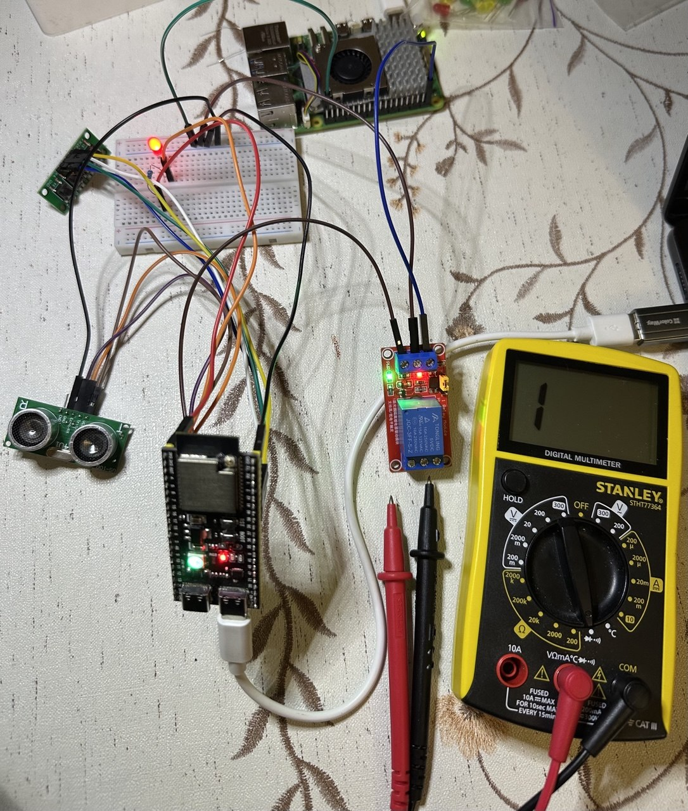

# Реальний стенд SENTRY SWM-2

Фото стенда від 24.10.2026, надане автором проєкту. Опис обладнання та підключення враховує його пояснення до фото.

## Обладнання

| Компонент | Призначення у поточному стенді |
|---|---|
| ESP32-S3 N16R8 | DUT із прошивкою SENTRY SWM-2. Команди надходять із Mac через USB/UART 115200 8N1. |
| Raspberry Pi 5 | Джерело живлення 5 В для модуля реле. Запуск HIL-агента на Pi у цьому ручному прогоні не заявляється. |
| Модуль реле 5 В | Вихід DUT: сигнал керування з GPIO8 ESP32-S3, окреме живлення від Pi. Контакти COM/NO/NC призначені для перевірки мультиметром без зовнішнього навантаження. |
| Зовнішній LED і резистор 220 Ом | Фізична індикація стану реле через GPIO4. Резистор 220 Ом зазначив автор стенда. |
| Кнопки панелі оператора | Ручне керування функціями SENTRY. |
| Ультразвуковий датчик відстані | Реальний вхід для перевірок вимірювання відстані. |
| Макетна плата та з'єднувальні дроти | Монтаж LED і сигнальних з'єднань. |
| Мультиметр Stanley STHT77364 | Режим прозвонювання для перевірки замикання COM–NO та COM–NC. |

## Підключення реле

За описом підключення: Raspberry Pi 5, фізичний пін 2 (5V), живить VCC модуля; пін 6 (GND) з'єднаний із GND модуля. Для неізольованого керування GND ESP32-S3 спільна з GND модуля та Pi. GPIO8 ESP32-S3 підключений до IN модуля. Тип тригера та допустимі рівні IN звіряються зі схемою конкретного модуля; позначення котушки «5 В» саме по собі не визначає рівень керування.

Зовнішній LED за схемою проєкту: 3V3 → резистор 220 Ом → анод LED, катод → GPIO4 (active LOW). Підключення змінюють при вимкненому живленні. Контакти COM/NO/NC під час прозвонювання не підключають до навантаження або зовнішнього джерела напруги.

## Поточне спостереження та перевірки

Автор підтвердив виконання ручних перевірок на поточній 2.3.0: контакти COM–NO / COM–NC правильно перемикаються при ON/OFF, зовнішній LED світиться при ON і гасне при OFF. TC-RL-03 і TC-RL-02 — Pass. Джерело — [звіт за повідомленням виконавця](../logs/manual-2.3.0-01/OPERATOR_REPORT.md); фото показує загальний стенд та LED при ON. Окремого відео прозвонювання не надано.

На 2.3.0 залишилися TC-LM-09 і TC-LM-10 (вбудований RGB). На 2.1.0 потрібно виконати всі чотири ручні кейси. Порядок команд, очікування та журнал параметрів наведені в [інструкції ручного прогону](MANUAL_RUN.md).

Для TC-RL-03 фіксуються всі чотири вимірювання: ON і off для COM–NO та COM–NC. Для TC-RL-02 окремо фіксується світіння LED при ON і відсутність світіння при off. Перед кожним прогоном записують версію прошивки. Фото загального вигляду доповнюють доказами конкретних перевірок.

[Теоретичний HIL-стенд](HIL_STAND.md) описує подальшу автоматизацію з RP2040, макетом клапана та CI. Його компоненти й функції обліковуються окремо від поточного реального стенда.
